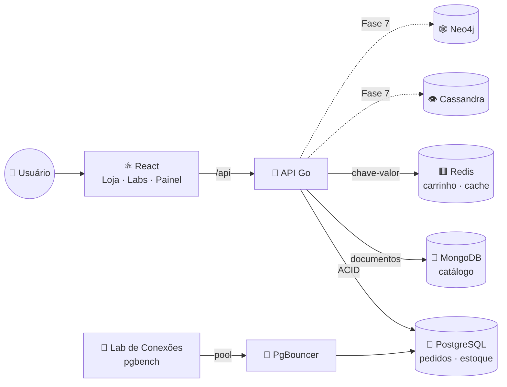

# nosqlGo


**Um marketplace para estudar bancos de dados.** Cada parte do sistema usa o
banco mais adequado ao problema: pedidos e estoque no PostgreSQL (ACID),
catálogo no MongoDB (documentos), carrinho e cache no Redis (chave-valor) e,
mais adiante, eventos no Cassandra e recomendações no Neo4j. Um **Painel do
DBA** e dois **laboratórios** mostram o que acontece por dentro: planos de
execução, locks, concorrência, auditoria e o estado de cada banco.

O roteiro segue os tópicos 8.1–8.12 de um edital e avança em **fases**. Cada
tópico tem um documento em [`docs/`](docs/) com o conceito, onde ele aparece no
código, exercícios e **fontes para pesquisa**. Roda só localmente, pelo Docker
Compose.

---

## O que ele faz

- **Loja simulada**: início com vitrine, "Entrar como" (login simulado), meus
  pedidos e página do pedido. Cada bloco da tela tem um **selo** dizendo de
  qual banco veio, e uma explicação em duas camadas ("Em uma frase" e "Por dentro").
- **Catálogo**: MongoDB com busca textual, filtro por categoria
  (array de ancestrais) e facetas numa só agregação; página do produto com
  cache no Redis, ofertas com preço e estoque vivos do PostgreSQL e avaliações
  gravadas numa transação multi-documento.
- **Carrinho**: um HASH no Redis por sessão, com TTL; o checkout é uma
  transação ACID no PostgreSQL, idempotente, e só depois do COMMIT o Redis
  atualiza o ranking de mais vendidos e o stream de pedidos.
- **Relatórios**: `CUBE`, funções de janela, curva ABC e CTE recursiva sobre
  uma materialized view.
- **Material de estudo** (`/estudo`): os documentos de `docs/` renderizados no app,
  com tabelas, diagramas Mermaid, links entre documentos e as fontes para pesquisa —
  o app lê os próprios arquivos `.md`, não uma cópia.
- **10 laboratórios**, agrupados pelo serviço do `docker-compose.yml` de que dependem
  (`postgres`, `postgres-replica`, `pgbouncer`, `mongo`, `redis` e os clusters do perfil `ha`;
  `cassandra` e `neo4j` nas próximas fases):
  | Laboratório | O que mostra |
  |---|---|
  | Concorrência | 50 compradores disputando o último item; o *lost update* |
  | Isolamento e deadlock | duas transações passo a passo em cada nível de isolamento |
  | Índices | `EXPLAIN (ANALYZE, BUFFERS)` antes e depois de cada índice, ajustes de sessão, *partition pruning* |
  | MVCC e VACUUM | tuplas mortas, HOT update, VACUUM × VACUUM FULL |
  | Particionamento e expurgo | DELETE × DROP PARTITION (tempo, WAL, espaço) |
  | Conexões e PgBouncer | conexão nova × PgBouncer × pool; o limite de `max_connections` |
  | Cache | MongoDB direto × cache-aside no Redis |
  | Replicação | cada `synchronous_commit`: o custo do COMMIT e se a linha já está na réplica |
  | Backup e PITR | full/diff/incr com pgBackRest; recuperar um `DROP TABLE` até o instante anterior |
  | Alta disponibilidade | derrubar o líder de Patroni, MongoDB (replica set) e Redis (Sentinel): RTO e RPO medidos |
- **Painel do DBA** em abas: saúde dos bancos, gráficos ao vivo, tabelas
  (tamanho, tuplas mortas, autovacuum), índices nunca usados, `shared_buffers`,
  consultas, locks, Redis, MongoDB, PgBouncer, auditoria e manutenção.

---

## 🧰 Stack

| | Tecnologia | Papel | Documento |
|---|---|---|---|
| 🐘 | **PostgreSQL 18** | clientes, pedidos, pagamentos, estoque, auditoria (ACID) | [01](docs/01-modelagem-dados.md) · [02](docs/02-sql.md) · [03](docs/03-transacoes-acid.md) · [04](docs/04-indices-otimizacao.md) · [05](docs/05-procedures-triggers-views.md) · [06](docs/06-postgresql-admin.md) |
| 🍃 | **MongoDB 9** | catálogo: atributos por categoria, avaliações, `$jsonSchema` | [07](docs/07-nosql.md#mongodb--documentos) |
| 🟥 | **Redis 8** | carrinho, cache-aside, rate limit, ranking, stream de pedidos | [07](docs/07-nosql.md#redis--chave-valor) |
| 🔀 | **PgBouncer 1.26** | pooler em modo transaction (Laboratório de Conexões, `make pgbench`) | [06](docs/06-postgresql-admin.md#5-pool-de-conexões-pgbouncer-fase-4) |
| 👁️ | **Cassandra 5** | eventos de navegação (Fase 7; não sobe antes) | [07](docs/07-nosql.md#cassandra--wide-column) |
| 🕸️ | **Neo4j 2026** | recomendações (Fase 7; não sobe antes) | [07](docs/07-nosql.md#neo4j--grafos) |
| 🐹 | **Go 1.27** | API (chi, pgx, sqlc, goose, mongo-driver, go-redis) | [11](docs/11-stack-go-react-docker.md) |
| ⚛️ | **React 19 · Vite 8 · TypeScript 7 · Recharts** | SPA servida pelo nginx; gráficos do painel | [11](docs/11-stack-go-react-docker.md) |
| 🧪 | **Testcontainers · Playwright** | integração com bancos efêmeros; E2E num stack isolado | [11](docs/11-stack-go-react-docker.md#testes) |
| 🪞 | **Réplica PostgreSQL** | streaming replication; os relatórios leem dela | [08](docs/08-replicacao-backup.md#31-réplica-por-streaming) |
| 🛡️ | **pgBackRest 2.58** | arquivamento do WAL, backups full/diff/incr, PITR | [08](docs/08-replicacao-backup.md#33-backup-com-pgbackrest--pitr) |
| ♻️ | **Patroni · etcd · HAProxy · Sentinel** | clusters de laboratório para failover (perfil `ha`) | [09](docs/09-alta-disponibilidade.md) |
| 🔐 | **RLS · roles · pgcrypto** | segurança e LGPD (Fase 6) | [10](docs/10-seguranca-governanca.md) |

---

## 📐 Arquitetura



Preço e estoque **vivem só no PostgreSQL**; o MongoDB e o Redis guardam cópias
para leitura rápida. Não há transação entre bancos: o Redis só é atualizado
depois do COMMIT. Detalhes em [docs/00-arquitetura.md](docs/00-arquitetura.md).

---

## 🚀 Rodar

Pré-requisito: **Docker** com Compose v2. Para desenvolver fora do Docker:
Go 1.27+ e Node 24+.

```bash
make up      # núcleo: postgres, mongo, redis, api, web → http://localhost:3000
make seed    # dados de estudo: 100 mil pedidos, ~1000 produtos, 7 mil avaliações (~10 s)
```

| | Comando | O que faz |
|---|---|---|
| 🐳 | `make up` / `make down` | stack de desenvolvimento (só o núcleo) |
| 🌱 | `make seed` | **apaga** e recria os dados (PostgreSQL, catálogo, Redis) |
| ⚡ | `make check` | build, vet, testes unitários, build do frontend — sem Docker |
| 🐘 | `make check-db` | integração com bancos efêmeros — **exige Docker** |
| 🧭 | `make e2e` | o app inteiro pelo navegador, num stack isolado — **exige Docker** |
| 🔗 | `make links` | confere os links e âncoras das fontes dos laboratórios — **exige internet** |
| 📈 | `make pgbench` | benchmark: conexão nova × PgBouncer × conexões mantidas |
| 🧰 | `make up-tools` | + pgAdmin e RedisInsight |
| ♻️ | `make up-ha` | + clusters de alta disponibilidade (Patroni/etcd/HAProxy, Mongo `rsha`, Redis Sentinel; ~600 MB) |
| 🕸️ | `make up-nosql` | + Cassandra e Neo4j (só a partir da Fase 7; +1–2 GB de RAM) |
| ❓ | `make` | lista todos os alvos (psql, mongosh, redis-cli, sqlc, migration…) |

### Portas

| Serviço | Desenvolvimento | E2E (`nosqlgo-e2e`) | Acesso |
|---|---|---|---|
| frontend | `3000` | `23000` | — |
| API | `8080` | `28080` | — |
| PostgreSQL | `5432` | `25432` | `marketplace` / `marketplace` |
| PostgreSQL réplica | `5433` | `25433` | só leitura; replicação com `replicador` / `replicador` |
| MongoDB | `27017` | `27117` | sem autenticação (pendente: fase-6 §7); `?directConnection=true` do host |
| Redis | `6379` | `26379` | sem senha (pendente: fase-6 §7) |
| PgBouncer | `6432` | `26432` | `marketplace` / `marketplace`; console: banco `pgbouncer` |
| Neo4j Browser | `7474` | — | `neo4j` / `marketplace123` |
| pgAdmin / RedisInsight | `5050` / `5540` | — | perfil `tools` |
| HAProxy (estatísticas) | `7000` | `27000` | perfil `ha`; os clusters de HA só são acessados de dentro da rede do compose |

As portas do E2E são outras de propósito: as duas stacks sobem juntas.

**Hot reload** (bancos no Docker, código local):

```bash
docker compose up -d postgres mongo redis
cp backend/.env.example backend/.env
make backend-run      # API em :8080
make frontend-dev     # React em http://localhost:5173 (proxy de /api → :8080)
```

> As credenciais são **de desenvolvimento**, propositalmente simples:
> a Fase 6 trouxe contas, RLS e CPF cifrado; tirar o superusuário da API,
> TLS e ACLs ainda estão pendentes (docs/fases/fase-6.md §7).

---

## 🧪 Testes

| | Nível | Onde | Bancos |
|---|---|---|---|
| ⚡ | unitário | `go test ./...`, build do front | nenhum |
| 🐘 | integração | `-tags=integration`, `internal/app` (servidor inteiro por HTTP), `loja/aplicacao`, `laboratorio/aplicacao`, `painel/aplicacao`, `plataforma/storage` | PostgreSQL, MongoDB e Redis **efêmeros** (Testcontainers) |
| 🧭 | E2E | `e2e/testes/` (Playwright na imagem oficial) | stack `nosqlgo-e2e` com o núcleo, semeado do zero |

Antes do código vem o **cenário de falha**: [`e2e/CENARIOS.md`](e2e/CENARIOS.md)
lista como cada funcionalidade pode quebrar, e cada teste cita o id que cobre.
O relatório de cada execução (resultado por cenário, print de cada tela,
imagens usadas) fica em `e2e/relatorio/resumo.md`. Nenhum teste toca no banco
de desenvolvimento, e Cassandra e Neo4j não sobem antes da Fase 7. As regras
completas estão no [`CLAUDE.md`](CLAUDE.md).

---

## 🗺️ Roadmap

Cada fase cobre um ou mais tópicos do edital e é dividida em **etapas**. Cada
etapa entrega três coisas:

1. **código** (migração SQL, consultas, endpoint, tela);
2. **documentação** (o conceito em `docs/NN-*.md` e o diário da fase em `docs/fases/fase-N.md`);
3. **uma forma de verificar** (teste, comando ou experimento na interface).

O diário de cada fase lista as etapas, a API criada, os resultados medidos e
os **exercícios para você**, ou seja, o que o código não faz por você.

| Fase | Diário |
|---|---|
| 1 | [docs/fases/fase-1.md](docs/fases/fase-1.md) |
| 2 | [docs/fases/fase-2.md](docs/fases/fase-2.md) |
| 3 | [docs/fases/fase-3.md](docs/fases/fase-3.md) |
| 4 | [docs/fases/fase-4.md](docs/fases/fase-4.md) |

### Fase 0 — Esqueleto ✅
- [x] Docker Compose com perfis (`nosql`, `tools`)
- [x] API Go conectando nos 5 bancos, com health check
- [x] Migrações com goose, configuração do sqlc
- [x] `postgresql.conf` comentado, `pg_stat_statements` habilitado
- [x] MongoDB em replica set (necessário para transações)
- [x] Painel do DBA v0: status dos bancos, visão geral do PG, top queries, sessões ativas

### Fase 1 — Modelagem relacional, SQL e transações · *8.1, 8.2, 8.4* ✅
- [x] 1.1 DER do domínio e esquema relacional na 3FN, com as decisões justificadas ([docs/01](docs/01-modelagem-dados.md#3-der-do-marketplace-implementado-na-fase-1))
- [x] 1.1 Migração: PK/FK (inclusive composta), `CHECK`, `UNIQUE`, `numeric` para dinheiro, `timestamptz`
- [x] 1.2 *Seed* com volume: 10 mil clientes, 2 mil SKUs, 100 mil pedidos (`make seed`)
- [x] 1.3 Consultas com sqlc (`db/queries/`)
- [x] 1.4 **Checkout transacional** com 4 estratégias de estoque, idempotência e retry em `40001`/`40P01`
- [x] 1.5 **Laboratório de Concorrência**: N goroutines disputando o último item (tela + teste de integração)
- [x] 1.6 Painel: tela de locks (`pg_locks` + `pg_blocking_pids`)
- [x] 1.7 Roteiros de lost update e **deadlock** no `psql` ([docs/03 §10](docs/03-transacoes-acid.md#10-roteiro-manual-com-psql-dois-terminais))
- [ ] Exercícios do estudante ([fase-1.md §4](docs/fases/fase-1.md#4-exercícios-para-você))

### Fase 2 — Índices, otimização, procedures, triggers e views · *8.2, 8.5, 8.6* ✅
- [x] 2.1 Triggers: **auditoria** genérica em `jsonb`, **event trigger** de DDL, `atualizado_em` e total do pedido
- [x] 2.2 Índices nas FKs (migração `00004`)
- [x] 2.3 **Laboratório de Índices**: 7 experimentos com `EXPLAIN (ANALYZE, BUFFERS)` antes/depois (B-tree, composto, parcial, expressão, GIN trigram, BRIN, work_mem)
- [x] 2.4 Função recursiva, view de mascaramento e **materialized view** com `REFRESH CONCURRENTLY`
- [x] 2.5 Procedures: refresh da MV e cancelamento em lotes com `COMMIT` interno
- [x] 2.6 Relatórios: `CUBE`, janelas com `RANGE`, curva ABC, CTE recursiva
- [x] 2.7 Seed 8× mais rápido (sem triggers) e em ordem cronológica
- [ ] Exercícios do estudante ([fase-2.md §5](docs/fases/fase-2.md#5-exercícios-para-você))

### Infraestrutura de testes ✅
- [x] Integração com bancos efêmeros (Testcontainers): migrations, checkout, procedures, servidor inteiro por HTTP
- [x] E2E com Playwright num stack isolado, catálogo de cenários e relatório com prints
- [x] [`CLAUDE.md`](CLAUDE.md) com as regras do projeto

### Fase 3 — NoSQL: documentos e chave-valor · *8.8* ✅
- [x] 3.1 Cenários de falha do catálogo e do carrinho escritos antes do código
- [x] 3.2 Catálogo no MongoDB: `$jsonSchema`, embedding × referencing, array de ancestrais, índices (texto, multikey, único)
- [x] 3.3 Busca com `$text` + `$facet` (itens, total e facetas numa agregação) e paginação
- [x] 3.4 Página do produto com **cache-aside** no Redis e invalidação; ofertas vivas do PostgreSQL
- [x] 3.5 Avaliações em **transação multi-documento**; resumo por `$group` + `$merge` (padrões Subset e Computed)
- [x] 3.6 Carrinho no Redis (HASH + TTL), checkout idempotente, ranking (ZSET), stream de pedidos, rate limit
- [x] 3.7 Painel: estado do Redis (INFO, SCAN por prefixo) e do MongoDB (`$collStats`, índices, replica set)
- [ ] Exercícios do estudante ([fase-3.md §5](docs/fases/fase-3.md#5-exercícios-para-você))

### Fase 4 — Administração e tuning do PostgreSQL · *8.7* ✅
- [x] 4.1 `pg_buffercache`, `pgstattuple`, fillfactor/autovacuum do estoque, **auditoria particionada por mês** com criação e expurgo de partições
- [x] 4.2 Painel: tamanho, tuplas mortas, HOT e autovacuum por tabela; índices nunca usados; o que está no `shared_buffers`; gráficos ao vivo
- [x] 4.3 PgBouncer (modo transaction) com configuração comentada, painel e `make pgbench`
- [x] 4.4 Ajustes de sessão (`enable_*`, `random_page_cost`, `work_mem`) e *partition pruning* no Lab de Índices
- [x] 4.5–4.9 Labs novos: **Isolamento e deadlock**, **MVCC e VACUUM**, **Particionamento e expurgo**, **Conexões e PgBouncer**, **Cache**
- [x] 4.10 Frontend didático: selos de banco, explicações em duas camadas, loja simulada, painel em abas
- [x] 4.11 Todo laboratório com tutorial **"do zero"** ilustrado e **fontes** por passo, opção e experimento (catálogo verificado por `make links`)
- [x] 4.12 **Material de estudo no app** (`docs/*.md` renderizado) e laboratórios **agrupados por serviço do compose**
- [ ] Exercícios do estudante ([fase-4.md §6](docs/fases/fase-4.md#6-exercícios-para-você))

### Fase 5 — Replicação, backup e alta disponibilidade · *8.10, 8.11* ✅
- [x] 5.1–5.2 Réplica PostgreSQL por streaming replication (slot, `pg_basebackup -R`); **relatórios lidos da réplica** com *read-your-writes* por LSN
- [x] 5.3 Painel → Replicação: os quatro LSNs, atrasos, slot, arquivamento e o lado da réplica
- [x] 5.4 **Lab de Replicação**: os cinco `synchronous_commit`, com e sem carga
- [x] 5.5 pgBackRest: arquivamento do WAL, backups full/diff/incr e **PITR** de um `DROP TABLE` numa instância à parte
- [x] 5.6–5.8 Perfil `ha`: Patroni + etcd + HAProxy, replica set Mongo de 3 nós, Redis + Sentinel; **Lab de Alta Disponibilidade** (queda × troca planejada)
- [x] 5.9 RPO/RTO medidos ([fase-5.md §3](docs/fases/fase-5.md#3-resultados-medidos))
- [x] 5.10 Backend em **arquitetura hexagonal**: contextos loja, laboratório e painel ([docs/12](docs/12-arquitetura-hexagonal.md))
- [x] 5.11 Tema escuro retrofuturista "Neon 3000" e menu fluido (três grupos; recolhe no celular)
- [ ] Exercícios do estudante ([fase-5.md §6](docs/fases/fase-5.md#6-exercícios-para-você))

### Fase 6 — Segurança e governança · *8.12* ✅
- [x] 6.1–6.4 **Cadastro e login**: senha em argon2id (na API), sessão no Redis com TTL (hash do token), cookie `HttpOnly`/`SameSite`
- [x] 6.5 A compra, a avaliação e "Meus pedidos" são **da conta logada**; saíram a lista pública de clientes e o pedido aberto por id
- [x] 6.6 **Row-Level Security**: o cliente só vê os próprios pedidos (papel `loja_cliente`)
- [x] 6.7 Menor privilégio: relatórios com o papel `relatorio_leitura` (só `SELECT`)
- [x] 6.8 `pgcrypto` para o CPF (cifrado + HMAC para o UNIQUE) e visão mascarada
- [x] 6.9 LGPD: inventário de dados pessoais e "excluir minha conta" (anonimiza; pedidos ficam)
- [ ] API sem superusuário, TLS no Postgres, ACL no Redis e autenticação no Mongo da loja, Docker secrets ([fase-6.md §7](docs/fases/fase-6.md#7-observações-para-as-próximas-fases))
- [ ] Exercícios do estudante ([fase-6.md §6](docs/fases/fase-6.md#6-exercícios-para-você))

### Fase 7 — Wide-column e grafo · *8.8*
- [ ] Eventos de navegação no Cassandra ("vistos recentemente") com TTL
- [ ] Explorar consistência ajustável (`ONE`, `QUORUM`, `ALL`)
- [ ] Neo4j: grafo Cliente–COMPROU→Produto alimentado pelos pedidos
- [ ] Recomendações com Cypher; comparar com a mesma consulta em SQL recursivo
- [ ] Tabela comparativa final: CAP/PACELC, consistência e casos de uso de cada banco

## 📁 Estrutura de pastas

```
nosqlGo/
├── README.md                  ← você está aqui
├── CLAUDE.md                  ← regras do projeto (testes, bancos, documentação)
├── docker-compose.yml         ← todos os serviços (perfis nosql/tools)
├── Makefile                   ← atalhos (make help)
├── e2e/                       ← Playwright: CENARIOS.md, testes/, rodar.sh, relatório
├── docs/                      ← material de estudo, um arquivo por tópico
│   └── fases/                 ← diário de cada fase (etapas, resultados, exercícios)
├── infra/
│   ├── postgres/              ← imagem (+pgBackRest), entrypoint (primário/réplica), postgresql.conf, pg_hba.conf
│   ├── pgbackrest/            ← (Fase 5) configuração do pgBackRest
│   ├── redis/                 ← redis.conf (persistência RDB/AOF)
│   ├── pgbouncer/             ← pgbouncer.ini comentado (Fase 4)
│   ├── patroni/ · haproxy/    ← (Fase 5, perfil ha) nó Patroni com supervisor; HAProxy
│   ├── mongo-ha/ · redis-ha/  ← (Fase 5, perfil ha) replica set rsha; Redis + Sentinel
│   ├── cassandra/             ← keyspace e tabelas (CQL)
│   └── pgadmin/               ← servidor pré-cadastrado
├── backend/
│   ├── cmd/api/main.go        ← ponto de entrada
│   ├── cmd/seed-catalogo/     ← monta o catálogo (Mongo) e o Redis a partir do PostgreSQL
│   ├── db/migrations/         ← SQL versionado (goose): tabelas, triggers, views...
│   ├── db/queries/            ← SQL das consultas (sqlc gera o Go)
│   ├── db/seed/               ← dados de estudo (make seed)
│   └── internal/              ← arquitetura hexagonal (docs/12): cada contexto tem dominio · portas · aplicacao · adaptadores
│       ├── loja/              ← o marketplace: checkout ACID, carrinho, catálogo, vitrine, relatórios
│       │   ├── dominio/       ← Pedido, Carrinho, Produto… e as regras (sem banco, sem HTTP)
│       │   ├── portas/        ← interfaces do que os casos de uso pedem aos bancos
│       │   ├── aplicacao/     ← casos de uso: Checkout.Finalizar (com nova tentativa), Carrinho, Catalogo (cache-aside)
│       │   └── adaptadores/   ← postgres (sqlc) · mongo (pipelines, $jsonSchema, seed) · redis (chaves) · http (rotas)
│       ├── laboratorio/       ← os 10 laboratórios (concorrência, isolamento, MVCC, índices, cache, replicação, backup, HA…)
│       │   └── adaptadores/   ← postgres · catalogo e loja (pontes para a loja) · ha (Patroni, Mongo rsha, Sentinel) · http
│       ├── painel/            ← Painel do DBA: visão geral, locks, saúde, manutenção, auditoria, réplica, Redis, Mongo, PgBouncer
│       ├── plataforma/        ← o que é de todos: config, storage (conexões e migrações), health, httpx, limite, testinfra
│       ├── sqlcdb/            ← código GERADO pelo sqlc (não editar)
│       ├── app/               ← a raiz de composição: liga tudo (API e testes usam a mesma) + teste da regra de dependência
│       ├── events/            ← (Fase 7) Cassandra
│       └── recommend/         ← (Fase 7) Neo4j
└── frontend/
    └── src/
        ├── api/client.ts      ← chamadas e tipos da API
        ├── components/ui.tsx  ← selo de banco, explicação em duas camadas, conclusão
        ├── pages/loja/        ← início, catálogo, produto, carrinho, meus pedidos
        ├── pages/labs/        ← os 10 laboratórios e o hub
        ├── pages/RelatoriosPage.tsx
        └── pages/dba/         ← Painel do DBA (abas)
```

## 📌 Versões

Verificadas nos registros oficiais em **2026-11-01**.

| Ferramenta | Versão | Observação |
|---|---|---|
| Go | 1.27.3 | imagem `golang:1.27.3-alpine` |
| PostgreSQL | 18.6 | o 19 está em *release candidate*; atualizar quando sair a versão estável |
| MongoDB | 9.0.4 | |
| Redis | 8.10.3 | Redis 8 já traz JSON, Search e TimeSeries embutidos |
| Apache Cassandra | 5.0.9 | |
| Neo4j Community | 2026.10.1 | versionamento por calendário (ano.mês) |
| Node.js | 26.13.0 LTS | só para o build do frontend |
| nginx | 1.31.8 | serve o build do React |
| React | 19.3.1 | |
| Vite | 8.3.5 | |
| TypeScript | 7.0.2 | compilador nativo (reescrito em Go) |
| React Router | 8.5.1 | |
| TanStack Query | 5.105.1 | |
| pgx | 5.12.0 | driver PostgreSQL |
| sqlc | 1.31.1 | gera Go a partir de SQL |
| google/uuid | 1.6.0 | tipo UUID no Go |
| PgBouncer | 1.26.1 | imagem `edoburu/pgbouncer:v1.26.1-p0` |
| pgBackRest | 2.58.0 | pacote do Alpine 3.24 na imagem do PostgreSQL (a 2.60 só compilando do fonte) |
| Patroni | 4.1.5 | `pip install patroni[etcd3]` sobre `postgres:18.6-alpine` (perfil `ha`) |
| etcd | 3.7.3 | `quay.io/coreos/etcd:v3.7.3` (perfil `ha`) |
| HAProxy | 3.4.7 | `haproxy:3.4.7-alpine` (perfil `ha`) |
| Recharts | 3.10.1 | gráficos do painel e dos laboratórios |
| react-markdown · remark-gfm | 10.1.0 · 4.0.1 | material de estudo: `docs/*.md` no app (tabelas GFM) |
| Mermaid | 12.2.0 | diagramas dos `.md` no app (carregado só quando um documento com diagrama abre) |
| testcontainers-go | 0.44.0 | bancos efêmeros nos testes de integração |
| Playwright | 1.64.1 | E2E (imagem `mcr.microsoft.com/playwright:v1.64.1-noble`) |
| goose | 3.29.0 | migrações |
| chi | 5.5.0 | roteador HTTP |
| mongo-go-driver | 2.9.2 | |
| go-redis | 9.23.0 | |
| cassandra-gocql-driver | 2.1.2 | driver oficial Apache (sucessor do `gocql/gocql`) |
| neo4j-go-driver | 6.4.0 | |
| pgAdmin 4 | 9.19 | perfil `tools` |
| RedisInsight | 3.8.0 | perfil `tools` |

Para conferir novas versões: `go list -m -u all` (backend), `npm outdated` (frontend)
e as tags no [Docker Hub](https://hub.docker.com/).

## 📚 Guia de estudo

Ordem sugerida, seguindo as fases. Os mesmos documentos estão no app, em **Material** (`/estudo`).

| # | Documento | Tópico |
|---|---|---|
| 00 | [Arquitetura](docs/00-arquitetura.md) | Persistência poliglota, visão geral |
| 01 | [Modelagem de dados](docs/01-modelagem-dados.md) | 8.1: MER, normalização, desnormalização |
| 02 | [Linguagem SQL](docs/02-sql.md) | 8.2: DDL, DML, JOINs, CTEs, janelas |
| 03 | [Transações e ACID](docs/03-transacoes-acid.md) | 8.4: isolamento, MVCC, locks, deadlock |
| 04 | [Índices e otimização](docs/04-indices-otimizacao.md) | 8.5: tipos de índice, EXPLAIN |
| 05 | [Procedures, triggers e views](docs/05-procedures-triggers-views.md) | 8.6: PL/pgSQL |
| 06 | [Administração do PostgreSQL](docs/06-postgresql-admin.md) | 8.7: VACUUM, tuning, pooling, particionamento |
| 07 | [NoSQL](docs/07-nosql.md) | 8.8: documento, chave-valor, wide-column, grafo, CAP |
| 08 | [Replicação e backup](docs/08-replicacao-backup.md) | 8.10: WAL, streaming, PITR |
| 09 | [Alta disponibilidade](docs/09-alta-disponibilidade.md) | 8.11: failover, consenso, RPO/RTO |
| 10 | [Segurança e governança](docs/10-seguranca-governanca.md) | 8.12: RBAC, RLS, criptografia, LGPD |
| 11 | [Stack Go, React e Docker](docs/11-stack-go-react-docker.md) | Ferramentas do projeto |
| 12 | [Arquitetura hexagonal](docs/12-arquitetura-hexagonal.md) | Como o backend se organiza: domínio, portas, casos de uso, adaptadores |

### Bibliografia geral

- KLEPPMANN, M. *Designing Data-Intensive Applications*. O'Reilly (2ª ed. em coautoria com C. Riccomini). A melhor visão geral de replicação, particionamento, transações e NoSQL.
- ELMASRI, R.; NAVATHE, S. *Sistemas de Banco de Dados*. Pearson. Texto clássico para MER, normalização e álgebra relacional.
- SILBERSCHATZ, A.; KORTH, H.; SUDARSHAN, S. *Sistema de Banco de Dados*. Outro clássico, forte em transações e recuperação.
- HEUSER, C. A. *Projeto de Banco de Dados*. Bookman. Modelagem conceitual e lógica, em português.
- SADALAGE, P.; FOWLER, M. *NoSQL Essencial* (*NoSQL Distilled*). Novatec. Os quatro modelos NoSQL e a persistência poliglota.
- [Documentação oficial do PostgreSQL](https://www.postgresql.org/docs/current/)
- [Use The Index, Luke!](https://use-the-index-luke.com/): índices e desempenho de SQL, gratuito (em inglês)
- [The Internals of PostgreSQL](https://www.interdb.jp/pg/): como o Postgres funciona por dentro
