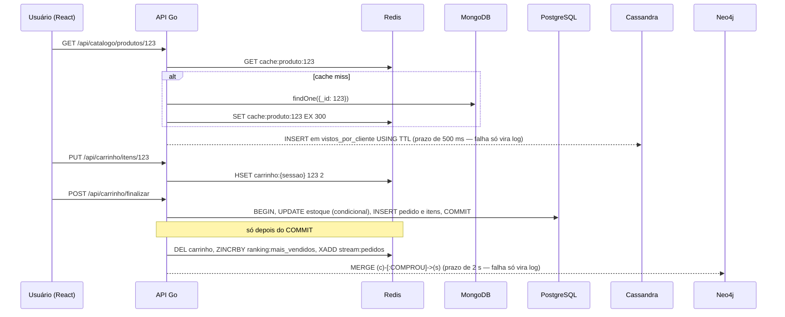

# 00 · Arquitetura e persistência poliglota

## A ideia central

**Persistência poliglota** (*polyglot persistence*) significa usar bancos de
dados diferentes para problemas diferentes dentro do mesmo sistema, em vez de
forçar tudo num único banco. O termo foi popularizado por Martin Fowler e
Pramod Sadalage.

Use isso com critério. Cada banco a mais traz custo de operação (backup,
monitoramento, segurança, conhecimento da equipe). Num sistema real, muitas
destas necessidades seriam atendidas **só pelo PostgreSQL** (JSONB no lugar do
Mongo, `UNLOGGED` tables ou cache em memória no lugar do Redis...). Aqui
usamos todos **porque o objetivo é estudar**, e os documentos sempre discutem
quando valeria ou não a pena.

## Quem guarda o quê

| Dado | Banco | Critério de escolha |
|---|---|---|
| Pedido, pagamento, estoque | PostgreSQL | Precisa de atomicidade e consistência forte; erro custa dinheiro |
| Página de produto | MongoDB | Estrutura varia por categoria; lido inteiro de uma vez |
| Carrinho, sessão, cache | Redis | Temporário (TTL), acesso por chave, latência mínima |
| Eventos de navegação | Cassandra | Volume alto de escrita, consultado por usuário+tempo |
| Recomendações | Neo4j | A pergunta é sobre **relacionamentos** (caminhos no grafo) |

## Fluxo de uma compra (alvo final)



Repare que **só o checkout é transacional**. Cassandra e Neo4j são
atualizados depois, como efeito secundário com prazo curto: se falharem, a
página e a compra continuam valendo (cenários X4 e Y4). Isso é **consistência
eventual** entre os bancos. Na Fase 7 a aresta perdida volta quando o grafo é
**reconstruído a partir dos pedidos** (o PostgreSQL é a fonte da verdade).
O padrão para não perder nada no caminho é o **Transactional Outbox**: grava-se
um evento numa tabela `outbox` dentro da mesma transação do pedido, e um
*worker* o publica depois. Ele **não** está implementado; é um dos exercícios
de [fase-7.md](fases/fase-7.md#6-exercícios-para-você).

## Camadas do backend

```
cmd/api/main.go                      → lê a configuração e abre as conexões
internal/app                         → a raiz de composição: liga adaptadores, casos de uso e rotas
internal/<contexto>/dominio          → entidades e regras (loja, laboratorio, painel)
internal/<contexto>/portas           → interfaces do que os casos de uso pedem
internal/<contexto>/aplicacao        → casos de uso
internal/<contexto>/adaptadores/*    → postgres, mongo, redis, http… (a tecnologia)
internal/plataforma                  → conexões, migrações, health, rate limit, testinfra
db/migrations                        → esquema do PostgreSQL versionado
```

É a **arquitetura hexagonal** (portas e adaptadores), explicada em
[12 · Arquitetura hexagonal](12-arquitetura-hexagonal.md).

Por que não usar um ORM? Porque o objetivo é **aprender SQL**. Com o
[sqlc](https://docs.sqlc.dev/) você escreve o SQL à mão e recebe código Go
tipado. Se o SQL estiver errado, o erro aparece na hora de gerar o código, e
não em produção.

## Fontes para pesquisa

- FOWLER, M. [PolyglotPersistence](https://martinfowler.com/bliki/PolyglotPersistence.html)
- SADALAGE, P.; FOWLER, M. *NoSQL Essencial*. Novatec. Cap. 13, "Persistência poliglota".
- KLEPPMANN, M. *Designing Data-Intensive Applications*. Cap. 1–2 (modelos de dados) e cap. 11–12 (dados derivados).
- [Microservices.io: Transactional Outbox](https://microservices.io/patterns/data/transactional-outbox.html)
- [Microservices.io: Database per service](https://microservices.io/patterns/data/database-per-service.html)
