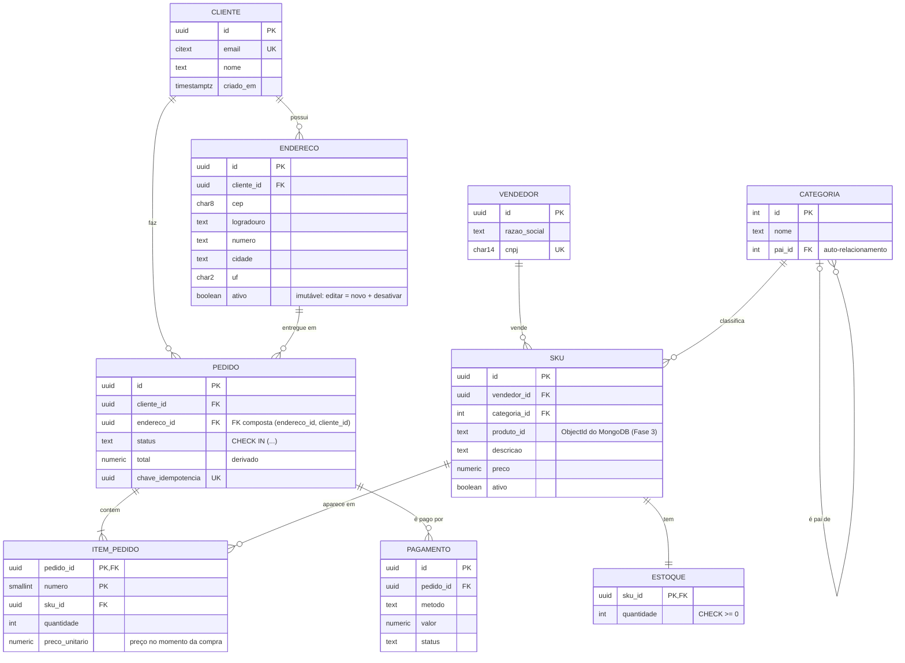

# 01 · Modelagem de dados: MER, normalização e desnormalização (8.1)

## 1. Os três níveis de modelagem

| Nível | Pergunta | Artefato | No projeto |
|---|---|---|---|
| **Conceitual** | *O que* existe no negócio? | Modelo Entidade-Relacionamento (MER/DER) | Diagrama abaixo |
| **Lógico** | Como fica em tabelas? | Modelo relacional: tabelas, PK, FK | Este documento, seção 4 |
| **Físico** | Como fica no SGBD escolhido? | DDL: tipos, índices, partições | `backend/db/migrations/*.sql` |

## 2. Conceitos do MER (Peter Chen, 1976)

- **Entidade:** algo do negócio com identidade própria (Cliente, Pedido).
  - **Entidade fraca:** só existe ligada a outra e não tem identificador
    próprio completo. Exemplo: **ItemPedido**, identificado por (pedido, nº do item).
- **Atributo:** propriedade da entidade.
  - simples x **composto** (endereço = rua + número + cidade);
  - monovalorado x **multivalorado** (telefones), que vira tabela própria;
  - **derivado** (idade, calculada a partir da data de nascimento; `total` do pedido).
  - **chave:** identifica a entidade (CPF, e-mail).
- **Relacionamento** e **cardinalidade**: 1:1, 1:N, N:M.
  - **Participação** total (obrigatória) x parcial (opcional).
  - N:M vira uma **tabela associativa** no modelo lógico.
- **Especialização/generalização:** Pessoa → Cliente e Vendedor. Há três
  formas de mapear isso para tabelas: uma tabela única com coluna de tipo, uma
  tabela por subclasse, ou uma por superclasse e mais uma por subclasse.

## 3. DER do marketplace (implementado na Fase 1)

O modelo físico está em
[`backend/db/migrations/00002_modelo_relacional.sql`](../backend/db/migrations/00002_modelo_relacional.sql).
Abra o arquivo junto com este diagrama: cada decisão está comentada no SQL.

### Decisões de modelagem (e por quê)

| Decisão | Motivo | Alternativa |
|---|---|---|
| **`item_pedido.preco_unitario`** repete o preço do SKU | O preço *no momento da compra* é outro fato: se o vendedor mudar o preço amanhã, o pedido antigo não muda | — |
| **Endereço imutável** (`ativo`) | Pedidos antigos apontam para ele; editar mudaria o endereço de entrega de pedidos já enviados | Copiar o endereço para dentro do pedido (desnormalização) |
| **FK composta** `pedido(endereco_id, cliente_id) → endereco(id, cliente_id)` | O banco garante que o endereço é do cliente do pedido. Uma FK simples não garantiria | Validar só na aplicação (frágil) |
| **`estoque` separado de `sku`** (1:1) | É a linha mais disputada do sistema; os locks do checkout não travam a linha do SKU | Coluna `sku.estoque` |
| **`categoria.pai_id`** (auto-relacionamento) | Hierarquia de profundidade variável; consultada com CTE recursiva | *Nested sets*, `ltree` |
| **Status com `CHECK IN (...)`** | Trocar a lista é só trocar a constraint | `ENUM` (mais compacto, mais rígido) ou tabela de domínio com FK |
| **`numeric(12,2)`** para dinheiro | Exato. `float` erra: `0.1 + 0.2 ≠ 0.3` | Inteiro em centavos (`bigint`) |
| **`chave_idempotencia UNIQUE`** | Repetir a requisição (timeout, duplo clique) não cria dois pedidos | Tabela própria de chaves com expiração |
| **`pedido.total`** guardado | Atributo derivado, evita somar itens em toda listagem. Mantido pelo trigger `trg_total_pedido` (Fase 2) | Calcular sempre (view) |
| **FKs sem índice na Fase 1** | Proposital: o PostgreSQL **não** indexa FKs sozinho. Criados na Fase 2 ([`00004`](../backend/db/migrations/00004_indices.sql)); o Lab de Índices mede a diferença (~100× menos páginas lidas) | — |
| **Produto no MongoDB, SKU no PostgreSQL** | O SKU guarda o que precisa de ACID (preço, estoque); a descrição rica e variável vai para documentos | Tudo no PG com JSONB |

### Em que forma normal está?

Todas as tabelas estão na **3FN** (e na FNBC): cada atributo não-chave depende
da chave, da chave inteira e de nada além da chave. A exceção consciente é
`pedido.total`, que é derivado: armazená-lo é desnormalização controlada (seção 5).

## 4. Normalização

A normalização elimina **anomalias** de inserção, atualização e exclusão
causadas por redundância. Ela se baseia em **dependências funcionais**
(DF): `A → B` quer dizer que "conhecendo A, B fica determinado".

| Forma normal | Regra | Violação no nosso domínio |
|---|---|---|
| **1FN** | Atributos atômicos; sem grupos repetidos | `pedido.itens = 'sku1:2, sku2:1'` |
| **2FN** | 1FN + nenhum atributo depende de **parte** da chave composta | Em `item_pedido(pedido_id, numero, ..., data_pedido)`, `data_pedido` depende só de `pedido_id` |
| **3FN** | 2FN + nenhuma dependência **transitiva** (não-chave → não-chave) | `pedido(cliente_id, cliente_email)`: o e-mail depende do cliente, não do pedido |
| **FNBC** | Todo determinante é chave candidata | Raro na prática; aparece em chaves candidatas sobrepostas |
| **4FN** | Sem dependências multivaloradas independentes | `vendedor(id, categoria, telefone)` mistura duas listas independentes |
| **5FN** | Sem dependências de junção | Teórico; cai em prova, raro no dia a dia |

**Exercício:** parta de uma "planilha" desnormalizada de pedidos (uma linha
por item, com todos os dados do cliente e do produto repetidos) e normalize
passo a passo até a 3FN. Registre as DFs que você encontrou.

## 5. Desnormalização

Desnormalizar é **introduzir redundância de propósito** para ganhar
desempenho de leitura. O preço é mais custo de escrita e risco de
inconsistência. Sempre que desnormalizar, responda: *quem mantém a cópia
atualizada?*

| Técnica | Onde no projeto | Quem mantém atualizado |
|---|---|---|
| Coluna derivada `pedido.total` | PostgreSQL | Trigger (Fase 2) |
| Materialized view `vendas_por_dia` | PostgreSQL | `REFRESH MATERIALIZED VIEW CONCURRENTLY` agendado |
| Avaliações **embutidas** no documento do produto | MongoDB | A própria escrita (atualização atômica do documento) |
| `nota_media` e `qtd_avaliacoes` no produto | MongoDB | `$inc` / pipeline na escrita |
| Cache do produto | Redis | TTL + invalidação na escrita (cache-aside) |
| Uma tabela por consulta | Cassandra | A aplicação escreve em todas as tabelas |

### Modelagem em NoSQL é orientada a consultas

No relacional, você modela **os dados** e depois escreve qualquer consulta.
No NoSQL, você parte **das consultas** e modela os dados para elas:

- **MongoDB:** "dados que são lidos juntos ficam juntos". Use *embedding*
  (embutir) para relação 1:poucos que é lida junto, e *referencing* para
  1:muitos ilimitado ou N:M. Há também padrões como *Subset*, *Computed*,
  *Bucket* e *Extended Reference*.
- **Cassandra:** uma tabela por padrão de consulta. Duplicar dados é o normal.
- **Redis:** você desenha **as chaves** (`carrinho:{sessao}`, `cache:produto:{id}`).
- **Neo4j:** nós e relacionamentos com propriedades (*property graph*).

## 6. Ferramentas

- Diagramas: [Mermaid erDiagram](https://mermaid.js.org/syntax/entityRelationshipDiagram.html) (renderiza no GitHub e no VS Code), [dbdiagram.io](https://dbdiagram.io/), [draw.io](https://www.drawio.com/)
- O pgAdmin (`make up-tools`) tem o *ERD Tool*, que gera o diagrama a partir do banco existente.

## Fontes para pesquisa

- CHEN, P. P. *The Entity-Relationship Model: Toward a Unified View of Data*. ACM TODS, 1976. [doi:10.1145/320434.320440](https://doi.org/10.1145/320434.320440)
- CODD, E. F. *A Relational Model of Data for Large Shared Data Banks*. CACM, 1970. [doi:10.1145/362384.362685](https://doi.org/10.1145/362384.362685)
- HEUSER, C. A. *Projeto de Banco de Dados*. Bookman. Caps. 2–4 (modelagem conceitual) e 5 (normalização).
- ELMASRI; NAVATHE. *Sistemas de Banco de Dados*. Caps. "Modelagem ER", "Mapeamento ER→relacional" e "Normalização".
- KENT, W. [*A Simple Guide to Five Normal Forms*](https://www.bkent.net/Doc/simple5.htm)
- MongoDB. [Data Modeling](https://www.mongodb.com/docs/manual/data-modeling/) e [Schema Design Patterns](https://www.mongodb.com/docs/manual/data-modeling/design-patterns/)
- Apache Cassandra. [Data Modeling](https://cassandra.apache.org/doc/latest/cassandra/developing/data-modeling/index.html)
- PostgreSQL. [Data Definition](https://www.postgresql.org/docs/current/ddl.html) e [Constraints](https://www.postgresql.org/docs/current/ddl-constraints.html)
