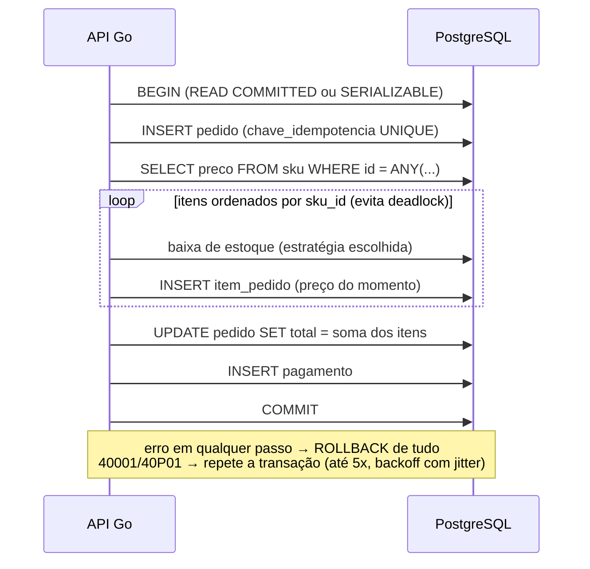

# 03 · Transações e propriedades ACID (8.4)

## 1. O que é uma transação

Uma transação é uma sequência de operações tratada como **uma unidade
indivisível**. No marketplace, o checkout é o exemplo perfeito: baixar o
estoque, criar o pedido e registrar o pagamento devem acontecer **todos ou
nenhum**.

## 2. ACID

| Propriedade | Significado | Como o PostgreSQL garante |
|---|---|---|
| **A**tomicidade | Tudo ou nada | `ROLLBACK` desfaz; o WAL registra o que foi confirmado |
| **C**onsistência | Sai de um estado válido para outro estado válido | Constraints (`CHECK quantidade >= 0`, FK, UNIQUE) e triggers |
| **I**solamento | Transações concorrentes não se atrapalham | **MVCC** + níveis de isolamento + locks |
| **D**urabilidade | Confirmado = não se perde, nem com queda de energia | **WAL** gravado em disco (`fsync`) antes do `COMMIT` retornar |

> O "C" do ACID **não** é o mesmo "C" do teorema CAP. No ACID, consistência
> é respeitar as regras de integridade. No CAP, é todas as réplicas
> enxergarem o mesmo dado (docs/07).

## 3. Anomalias de concorrência

| Anomalia | Exemplo no marketplace |
|---|---|
| **Dirty read** | Ler o estoque alterado por uma transação que depois faz rollback |
| **Non-repeatable read** | Ler o preço duas vezes na mesma transação e obter valores diferentes |
| **Phantom read** | `count(*)` dos pedidos pendentes muda entre duas leituras porque surgiu uma linha nova |
| **Lost update** | Duas compras leem estoque = 1, cada uma grava 0, e um item é vendido duas vezes |
| **Write skew** | Dois vendedores verificam "há pelo menos 1 admin ativo" e ambos se removem |
| **Serialization anomaly** | Resultado que nenhuma execução em série produziria |

## 4. Níveis de isolamento (SQL padrão x PostgreSQL)

| Nível | Dirty read | Non-repeatable | Phantom | Serialization anomaly |
|---|---|---|---|---|
| Read Uncommitted | possível (no PG: **não**) | possível | possível | possível |
| **Read Committed** (padrão PG) | não | possível | possível | possível |
| Repeatable Read | não | não | possível (no PG: **não**) | possível |
| **Serializable** (SSI no PG) | não | não | não | não |

No PostgreSQL, o *Read Uncommitted* se comporta como *Read Committed*, e o
*Repeatable Read* também impede phantoms porque usa um *snapshot* da
transação inteira. Em compensação, nos níveis mais altos o banco **aborta**
transações em conflito com o erro `40001 serialization_failure`, e a
aplicação **deve repetir** a transação.

## 5. MVCC: por que leitura não bloqueia escrita

O PostgreSQL usa **Multi-Version Concurrency Control**. Um `UPDATE` não
sobrescreve a linha: ele cria uma **nova versão** (tupla) e marca a antiga
como expirada (colunas ocultas `xmin`/`xmax`). Cada transação enxerga as
versões compatíveis com o seu *snapshot*. Consequências:

- leitores não bloqueiam escritores e escritores não bloqueiam leitores;
- versões antigas viram "lixo" (*dead tuples*), que o **VACUUM** limpa (docs/06).

```sql
SELECT xmin, xmax, * FROM estoque WHERE sku_id = '...';  -- veja as versões
```

## 6. Locks explícitos

```sql
-- Bloqueio pessimista: trava a linha até o fim da transação
SELECT quantidade FROM estoque WHERE sku_id = $1 FOR UPDATE;

-- Fila de processamento: pula linhas já travadas por outro worker
SELECT id FROM pedido WHERE status = 'PAGO' LIMIT 10 FOR UPDATE SKIP LOCKED;

-- Não espera: falha na hora se a linha estiver travada
SELECT ... FOR UPDATE NOWAIT;
```

Alternativas ao lock pessimista:

- **UPDATE condicional e atômico**, a forma mais simples e geralmente a melhor:
  ```sql
  UPDATE estoque SET quantidade = quantidade - $2
   WHERE sku_id = $1 AND quantidade >= $2;   -- 0 linhas afetadas = sem estoque
  ```
- **Lock otimista** com coluna `versao`: `UPDATE ... SET versao = versao + 1 WHERE id = $1 AND versao = $2`.
- **Advisory locks:** `pg_advisory_xact_lock(hash)` para travar um conceito, não uma linha.

## 7. Deadlock

Acontece quando T1 trava A e espera B enquanto T2 trava B e espera A. O
PostgreSQL detecta o ciclo após `deadlock_timeout` (1 s) e **aborta uma das
transações** (erro `40P01`).

**Prevenção:** travar os recursos sempre **na mesma ordem**. No checkout,
ordene os itens do carrinho por `sku_id` antes de dar `FOR UPDATE`.

## 8. O checkout do projeto

Código: [`backend/internal/loja/adaptadores/postgres/pedidos.go`](../backend/internal/loja/adaptadores/postgres/pedidos.go).
Consultas SQL: [`backend/db/queries/checkout.sql`](../backend/db/queries/checkout.sql).



Pontos de estudo no código:

- `pgx.BeginTxFunc` faz COMMIT se a função retorna `nil` e ROLLBACK se retorna erro. A **atomicidade** fica explícita.
- O pedido é o **primeiro** INSERT: uma requisição repetida (mesma `Idempotency-Key`) falha na UNIQUE antes de mexer no estoque e devolve o pedido existente.
- Os erros do PostgreSQL são tratados pelo **SQLSTATE**: `40001` (serialização), `40P01` (deadlock), `23505` (UNIQUE), `23503` (FK) e `23514` (CHECK).
- O `CHECK (quantidade >= 0)` é a **última linha de defesa** da consistência (o "C" do ACID): mesmo com bug na aplicação, o banco recusa estoque negativo.

## 9. Laboratório de Concorrência

Tela **Laboratório** no frontend (http://localhost:3000/lab) ou
`POST /api/lab/corrida`. N compradores tentam comprar 1 unidade do mesmo SKU
**ao mesmo tempo** (todas as goroutines partem de um canal fechado).
Código: [`backend/internal/laboratorio/aplicacao/corrida.go`](../backend/internal/laboratorio/aplicacao/corrida.go).

| Estratégia | O que faz | Isolamento |
|---|---|---|
| `ingenua` | `SELECT quantidade` → decide no Go → `UPDATE SET quantidade = <valor calculado>` | READ COMMITTED |
| `for_update` | `SELECT ... FOR UPDATE` → decide → `UPDATE SET quantidade = quantidade - x` | READ COMMITTED |
| `condicional` | `UPDATE ... SET quantidade = quantidade - x WHERE quantidade >= x` | READ COMMITTED |
| `serializavel` | Igual à ingênua, mas o PostgreSQL detecta o conflito e aborta (40001); a API repete | SERIALIZABLE |

### Resultados medidos (50 compradores, estoque 5)

| Estratégia | Atraso | Vendidos | Retentativas | Estoque final | Vendas a mais |
|---|---|---|---|---|---|
| ingênua | 0 ms | **45** | 0 | 0 | **40** |
| ingênua | 50 ms | **50** | 0 | 2 | **45** |
| for_update | 0 / 50 ms | 5 | 0 | 0 | 0 |
| condicional | 0 / 50 ms | 5 | 0 | 0 | 0 |
| serializável | 0 / 50 ms | 5 | 73 / 95 | 0 | 0 |

**Por que a ingênua falha:** várias transações leem `quantidade = 5` antes de
qualquer uma gravar; todas decidem "tem estoque" e gravam `4`. Cada escrita
**sobrescreve** a anterior, sem somar. É o *lost update*. O estoque final nem
fecha a conta (`5 − 50 ≠ 2`): o banco ficou **inconsistente** sem violar
nenhuma constraint.

**Por que `condicional` é a melhor aqui:** um único comando faz a verificação
e a escrita. O `UPDATE` trava a linha e, em READ COMMITTED, **reavalia o
`WHERE`** com a versão mais nova quando o lock é liberado. Não há ida e volta
entre ler e gravar, então o lock dura o mínimo possível.

**Por que `serializavel` precisa de retry:** o SSI do PostgreSQL deixa todas
lerem sem bloquear e aborta quem conflitou (`could not serialize access due to
concurrent update`). A aplicação **tem** de repetir. Sob disputa muito alta,
as 5 tentativas podem se esgotar e o comprador recebe erro (nunca uma venda a mais).

### Como os locks aparecem no Painel do DBA

Rode `for_update` com 10 compradores e **atraso de 400 ms** e olhe a tabela
**Locks** em http://localhost:3000/dba:

| PID | Tipo | Modo | Concedido | Objeto | Bloqueado por |
|---|---|---|---|---|---|
| 3532 | transactionid | ShareLock | **NÃO** | xid 1877 | 3522 |
| 3531 | tuple | AccessExclusiveLock | **NÃO** | estoque | 3532 |
| 3534 | tuple | AccessExclusiveLock | **NÃO** | estoque | 3532, 3531 |

Leitura: a sessão 3522 travou a linha. A 3532 é a **primeira da fila**: pegou
o lock da *tupla* e espera a **transação** 1877 (da 3522) terminar. Por isso
o lock é do tipo `transactionid`: no PostgreSQL, esperar uma linha é esperar
a transação que a alterou. As demais esperam na fila do lock da tupla.

## 10. Roteiro manual com `psql` (dois terminais)

Abra `make psql` em **dois** terminais (A e B). SKU do laboratório: `'11111111-1111-1111-1111-111111111111'`.

**Lost update (READ COMMITTED):**

```sql
-- A                                        -- B
BEGIN;                                      BEGIN;
SELECT quantidade FROM estoque WHERE sku_id = '1111...';   -- ambos leem 5
UPDATE estoque SET quantidade = 4 WHERE sku_id = '1111...';
                                            UPDATE estoque SET quantidade = 4 WHERE sku_id = '1111...';  -- espera A
COMMIT;                                     -- B continua e grava 4 também
                                            COMMIT;   -- duas vendas, estoque caiu só 1
```

**O mesmo em REPEATABLE READ:** troque `BEGIN` por
`BEGIN ISOLATION LEVEL REPEATABLE READ;`. O UPDATE de B falha com
`could not serialize access due to concurrent update`.

**Deadlock:**

```sql
-- A                                                -- B
BEGIN;                                              BEGIN;
UPDATE estoque SET quantidade = quantidade WHERE sku_id = (SELECT min(sku_id) FROM estoque);
                                                    UPDATE estoque SET quantidade = quantidade WHERE sku_id = (SELECT max(sku_id) FROM estoque);
UPDATE estoque SET quantidade = quantidade WHERE sku_id = (SELECT max(sku_id) FROM estoque);  -- espera B
                                                    UPDATE estoque SET quantidade = quantidade WHERE sku_id = (SELECT min(sku_id) FROM estoque);
                                                    -- após 1 s: ERROR: deadlock detected (40P01)
```

Veja o detalhe no log: `make logs s=postgres`. O checkout evita deadlock
**ordenando os itens por `sku_id`**: todas as transações travam as linhas
na mesma ordem.

## 10b. Laboratório de Isolamento e Deadlock (Fase 4)

A tela **Laboratórios → Isolamento e deadlock** (http://localhost:3000/lab/isolamento)
roda os roteiros da seção 10 sozinha: duas conexões de verdade, passo a passo,
no nível escolhido. Quando um passo fica mais de 400 ms sem resposta, ele está
**esperando um lock** e o roteiro segue com a outra transação. Código:
[`laboratorio/adaptadores/postgres/isolamento.go`](../backend/internal/laboratorio/adaptadores/postgres/isolamento.go). A tabela de
resultados (que o teste de integração confere em cada execução) está em
[fase-4.md §3](fases/fase-4.md#isolamento-comportamento-do-postgresql-18-confirmado-em-teste-de-integração).

## 11. E nos bancos NoSQL?

| Banco | Transação |
|---|---|
| MongoDB | Operação em **um documento** é sempre atômica. Desde a 4.0 há transações multi-documento (exigem replica set, por isso o compose sobe o Mongo como `rs0`). |
| Redis | `MULTI`/`EXEC` executa em bloco, sem rollback; `WATCH` dá lock otimista; scripts Lua e *functions* são atômicos. |
| Cassandra | Sem transações ACID clássicas; *lightweight transactions* (`IF NOT EXISTS`, via Paxos) e *batches* atômicos por partição. O Cassandra 5 vem preparando o **Accord** (transações ACID gerais). |
| Neo4j | ACID completo. |

Muitos NoSQL seguem o modelo **BASE** (*Basically Available, Soft state,
Eventually consistent*) em contraste com o ACID.

## Fontes para pesquisa

- PostgreSQL. [Transactions (tutorial)](https://www.postgresql.org/docs/current/tutorial-transactions.html)
- PostgreSQL. [Concurrency Control / MVCC](https://www.postgresql.org/docs/current/mvcc.html), em especial [Transaction Isolation](https://www.postgresql.org/docs/current/transaction-iso.html) e [Explicit Locking](https://www.postgresql.org/docs/current/explicit-locking.html)
- PostgreSQL. [Reliability and the WAL](https://www.postgresql.org/docs/current/wal.html)
- PORTS, D.; GRITTNER, K. *Serializable Snapshot Isolation in PostgreSQL*. VLDB 2012. [PDF](https://drkp.net/papers/ssi-vldb12.pdf)
- BERENSON, H. et al. *A Critique of ANSI SQL Isolation Levels*. SIGMOD 1995. [arXiv](https://arxiv.org/abs/cs/0701157)
- KLEPPMANN, M. *Designing Data-Intensive Applications*. Cap. 7, "Transactions".
- [Hermitage](https://github.com/ept/hermitage): testes de isolamento em vários bancos
- PostgreSQL. [Data Consistency Checks at the Application Level](https://www.postgresql.org/docs/current/applevel-consistency.html): por que write skew exige SERIALIZABLE ou locks explícitos
- SUZUKI, H. [The Internals of PostgreSQL, cap. 5: Concurrency Control](https://www.interdb.jp/pg/pgsql05.html): xmin/xmax e visibilidade, com desenhos
- As fontes de **cada passo e opção** dos Laboratórios de Concorrência e de Isolamento estão no próprio laboratório (catálogo em `frontend/src/components/fontes.tsx`)
- MongoDB. [Transactions](https://www.mongodb.com/docs/manual/core/transactions/)
- Redis. [Transactions](https://redis.io/docs/latest/develop/using-commands/transactions/)
- pgx. [Documentação do pacote](https://pkg.go.dev/github.com/jackc/pgx/v5)
