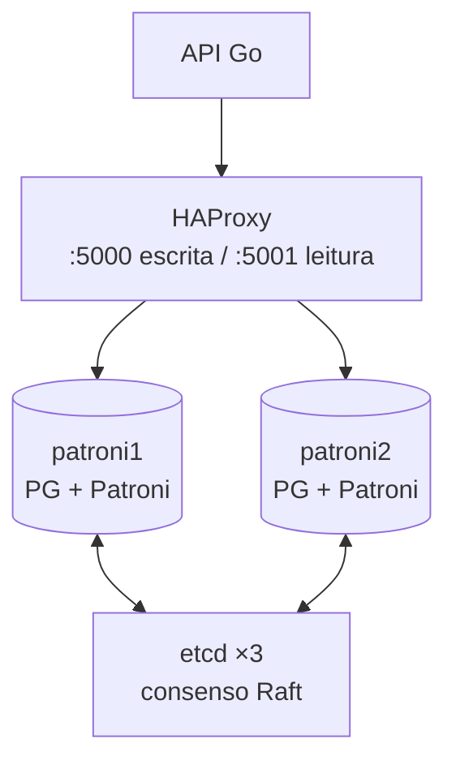

# 09 · Alta disponibilidade (8.11)

## 1. Conceitos

**Alta disponibilidade (HA)** é a capacidade de o sistema continuar
funcionando mesmo com falhas de componentes. Ela é medida em "noves":

| Disponibilidade | Indisponibilidade por ano |
|---|---|
| 99% | 3,65 dias |
| 99,9% | 8,76 horas |
| 99,99% | 52,6 minutos |
| 99,999% | 5,26 minutos |

Princípios:

- **Eliminar ponto único de falha (SPOF):** banco, balanceador, rede, energia...
- **Redundância + detecção de falha + failover automático.**
- **Failover** (automático, quando o primário cai) x **switchover** (planejado, para manutenção).
- **Split-brain:** dois nós acham que são primários e aceitam escritas
  divergentes. Evita-se com **quórum/consenso** (maioria = ⌊N/2⌋+1, por isso
  3 ou 5 nós) e **fencing/STONITH**.
- **HA ≠ backup ≠ DR.** HA protege contra a falha de um nó. *Disaster
  Recovery* protege contra a perda de um datacenter inteiro (réplica em outra região).

## 2. PostgreSQL: Patroni (Fase 5, perfil `ha`)

O PostgreSQL não tem failover automático nativo, e o **Patroni** preenche essa
lacuna. No projeto, um cluster **de laboratório** (`make up-ha`), ao lado do banco da loja:

1. Cada nó roda um agente Patroni que mantém uma **chave de líder com TTL** no etcd (aqui `ttl = 20`, renovada a cada `loop_wait = 5` s).
2. Se o líder parar de renovar a chave, ela expira e a réplica mais atualizada se elege.
3. O HAProxy consulta a API REST do Patroni (`GET /primary` na porta 8008) para saber para onde mandar a escrita ([`infra/haproxy/haproxy.cfg`](../infra/haproxy/haproxy.cfg)).
4. O antigo primário volta como réplica (`pg_rewind`, por isso `wal_log_hints = on`).

**Como o laboratório derruba o líder sem acesso ao Docker:** cada nó roda sob
um supervisor ([`infra/patroni/supervisor.sh`](../infra/patroni/supervisor.sh)). A
API mata o Patroni do líder (`COPY … TO PROGRAM 'kill -9 …'`); o supervisor
derruba o PostgreSQL do nó (`pg_ctl stop -m immediate`, o nó inteiro caindo),
espera mais que o TTL e sobe o Patroni de novo — que encontra outro líder e
volta como réplica. Medido: failover em **~18 s** (perto do TTL), troca
planejada (`POST /switchover`) em **~3 s**, nenhuma escrita confirmada perdida
([fase-5.md](fases/fase-5.md#3-resultados-medidos)).

`synchronous_mode` (ligado e desligado pelo laboratório com `PATCH /config`): o
Patroni mantém uma réplica síncrona e só promove ela — RPO zero.

Alternativas: repmgr, pg_auto_failover e, em Kubernetes, CloudNativePG.

## 3. MongoDB: replica set

Failover **nativo**: os membros trocam *heartbeats* a cada 2 s. Se o
primário some por `electionTimeoutMillis` (10 s), os secundários elegem um
novo primário (protocolo derivado do Raft). Os drivers redescobrem a
topologia sozinhos, então a string de conexão lista o replica set:
`mongodb://m1,m2,m3/?replicaSet=rs0`.

Membros especiais: *arbiter* (vota e não guarda dados), *hidden* e *delayed*
(réplica atrasada de propósito para se proteger de erro humano).

No projeto, o replica set de laboratório `rsha` tem 3 nós com autenticação por
**keyfile** ([`infra/mongo-ha/`](../infra/mongo-ha/)). Dois achados medidos:

- um `shutdown` comum faz ***election handoff***: o primário indica o sucessor e a
  troca leva ~0,1 s (nenhuma escrita falhou). Para simular uma **queda**, o
  laboratório desliga o `enableElectionHandoff` antes — e a troca passa a levar
  ~8 s (falta de heartbeats + eleição);
- `w: "majority"` confirma só quando 2 dos 3 têm a escrita, que então sobrevive à
  eleição; com `w: 1`, o que só o antigo primário tinha sofre *rollback* quando ele volta.

## 4. Redis: Sentinel x Cluster

| | **Sentinel** | **Redis Cluster** |
|---|---|---|
| Objetivo | HA de um primário com réplicas | HA **+ sharding** (16384 *hash slots*) |
| Failover | Sentinels (≥3) monitoram e promovem uma réplica por quórum | Os próprios nós votam |
| Cliente | Pergunta ao Sentinel quem é o primário | Segue redirecionamentos `MOVED`/`ASK` |

No go-redis: `redis.NewFailoverClient(&redis.FailoverOptions{MasterName: "principal", SentinelAddrs: ...})`.

No projeto ([`infra/redis-ha/`](../infra/redis-ha/)): primário + réplica, 3
sentinels com quórum 2 e `down-after-milliseconds = 5000`. O laboratório congela
o primário com `DEBUG SLEEP 30` (habilitado **só** nesse Redis de laboratório):
os sentinels promovem a réplica em **~6,6 s**, e quando o antigo acorda é
reconfigurado como réplica.

## 5. Cassandra

HA **por design**: não há primário. Com RF=3 e `QUORUM`, o cluster tolera a
queda de 1 nó por *range* sem nenhum failover. É o extremo "AP" do CAP (docs/07).

## 6. Na aplicação Go

HA não é só infraestrutura. A aplicação também precisa:

- **reconectar** (os pools pgxpool, mongo e go-redis já fazem isso);
- **repetir operações idempotentes** com *backoff* exponencial;
- ter **timeouts** em tudo (o projeto usa `context.WithTimeout`);
- expor um **health check** (`/api/health`) para o orquestrador tirar a instância do ar;
- separar **leitura** (réplica) de **escrita** (primário) com cuidado com o *read-your-writes*.

## Fontes para pesquisa

- [Patroni: documentação](https://patroni.readthedocs.io/en/latest/)
- [etcd: FAQ (por que número ímpar de membros)](https://etcd.io/docs/latest/faq/)
- [The Raft Consensus Algorithm](https://raft.github.io/), com visualização interativa
- PostgreSQL. [High Availability, Load Balancing, and Replication](https://www.postgresql.org/docs/current/high-availability.html)
- [HAProxy: documentação](https://docs.haproxy.org/)
- MongoDB. [Replica Set Elections](https://www.mongodb.com/docs/manual/core/replica-set-elections/)
- Redis. [High availability with Sentinel](https://redis.io/docs/latest/operate/oss_and_stack/management/sentinel/) e [Scale with Redis Cluster](https://redis.io/docs/latest/operate/oss_and_stack/management/scaling/)
- [CloudNativePG](https://cloudnative-pg.io/): HA de PostgreSQL em Kubernetes
- Google. [*Site Reliability Engineering*](https://sre.google/sre-book/table-of-contents/): livro gratuito; capítulos sobre SLO e disponibilidade
- ONGARO, D.; OUSTERHOUT, J. [*In Search of an Understandable Consensus Algorithm*](https://www.usenix.org/conference/atc14/technical-sessions/presentation/ongaro) (Raft). USENIX ATC, 2014
- Patroni. [Dynamic Configuration](https://patroni.readthedocs.io/en/latest/dynamic_configuration.html) · [REST API](https://patroni.readthedocs.io/en/latest/rest_api.html) · [Replication modes](https://patroni.readthedocs.io/en/latest/replication_modes.html)
- PostgreSQL. [pg_rewind](https://www.postgresql.org/docs/current/app-pgrewind.html)
- MongoDB. [Write Concern](https://www.mongodb.com/docs/manual/reference/write-concern/) · [Rollbacks During Failover](https://www.mongodb.com/docs/manual/core/replica-set-rollbacks/) · [replSetStepDown (election handoff)](https://www.mongodb.com/docs/manual/reference/command/replSetStepDown/) · [Retryable Writes](https://www.mongodb.com/docs/manual/core/retryable-writes/)
- Redis. [WAIT](https://redis.io/docs/latest/commands/wait/)
- KINGSBURY, K. [*Jepsen: Redis*](https://aphyr.com/posts/283-jepsen-redis) (2013) e [*Jepsen: MongoDB 4.2.6*](https://jepsen.io/analyses/mongodb-4.2.6) (2020): o que as garantias valem sob partições de rede
- As fontes de **cada passo e opção** do Laboratório de Alta Disponibilidade estão no próprio laboratório (catálogo em `frontend/src/components/fontes.tsx`)
