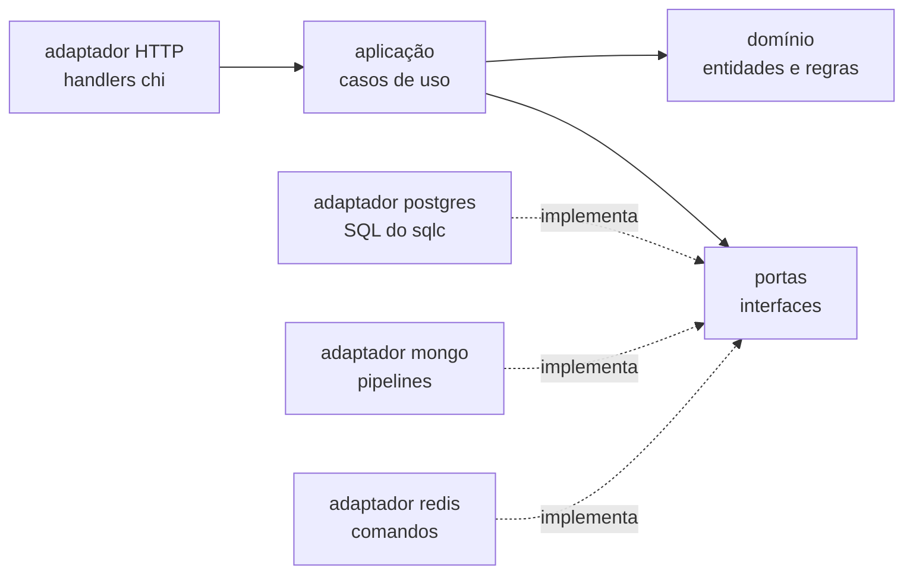

# 12 · Arquitetura do backend: hexagonal (portas e adaptadores)

## 1. A ideia em uma frase

O **centro** do código (as regras e os casos de uso) não sabe que existe
PostgreSQL, MongoDB, Redis nem HTTP. Ele declara do que precisa — as
**portas** — e peças na borda — os **adaptadores** — cumprem essas promessas
com cada tecnologia. Quem liga uma coisa à outra é um lugar só: a **raiz de
composição** (`internal/app`).



As setas cheias são **dependências de código**: todas apontam para dentro.
As tracejadas são "implementa": o adaptador conhece a porta, nunca o contrário.

## 2. As camadas

| Camada | O que tem | Pode importar | Exemplo |
|---|---|---|---|
| **dominio** | entidades, regras de negócio, erros do negócio | só a biblioteca padrão (e `uuid`) | `dominio.Normalizar(pedido)` ordena os itens contra deadlock |
| **portas** | interfaces do que a aplicação pede ao mundo | + o domínio | `portas.Pedidos.Criar(…)`: "grave este pedido, tudo ou nada" |
| **aplicacao** | os casos de uso: orquestram domínio e portas | + domínio e portas | `Checkout.Finalizar` repete a compra se o banco abortar por conflito |
| **adaptadores/** | a tecnologia: SQL, comandos do Redis, pipelines do Mongo, HTTP | tudo o que precisar | `postgres.Pedidos` abre a transação e traduz SQLSTATE em erro do domínio |

A regra é conferida por um teste, não por boa vontade:
[`internal/app/arquitetura_test.go`](../backend/internal/app/arquitetura_test.go)
lê os imports de cada pacote e falha se, por exemplo, um caso de uso importar o
`pgx` ou o adaptador HTTP falar direto com um banco.

## 3. Três contextos

```text
backend/internal/
├── loja/            o marketplace: pedidos, carrinho, catálogo, vitrine, relatórios
│   ├── dominio/  aplicacao/  portas/
│   └── adaptadores/  postgres/ mongo/ redis/ http/
├── laboratorio/     os experimentos dos laboratórios
│   ├── dominio/  aplicacao/  portas/
│   └── adaptadores/  postgres/ catalogo/ ha/ loja/ http/
├── painel/          o Painel do DBA
│   ├── dominio/  aplicacao/  portas/
│   └── adaptadores/  postgres/ mongo/ redis/ pgbouncer/ http/
├── plataforma/      o que é de todos: config, storage (conexões e migrações),
│                    httpx, health, limite (rate limit), testinfra
├── sqlcdb/          código GERADO pelo sqlc (usado só pelos adaptadores postgres)
└── app/             a raiz de composição: liga adaptadores → portas → casos de uso → rotas
```

Os contextos não se importam. A única exceção é desenhada: o **Laboratório de
Concorrência** compra pelo checkout de verdade da loja. Ele não importa os
tipos da loja na aplicação; quem fala com a loja é um adaptador-ponte
([`laboratorio/adaptadores/loja`](../backend/internal/laboratorio/adaptadores/loja/loja.go)),
que traduz um modelo no outro — a **camada anticorrupção**. O Laboratório de
Cache faz o mesmo para ler o produto no formato da loja.

## 4. Uma compra, camada por camada

`POST /api/carrinho/finalizar`:

1. **adaptador HTTP** ([`loja/adaptadores/http`](../backend/internal/loja/adaptadores/http/handlers.go)):
   lê a sessão e a `Idempotency-Key`, decodifica o JSON e chama o caso de uso.
2. **aplicação** ([`aplicacao.Carrinho.Finalizar`](../backend/internal/loja/aplicacao/carrinho.go)):
   lê o carrinho pela porta `Carrinhos`, chama `Checkout.Finalizar` e, só se der
   certo, os `EfeitosDoPedido`.
3. **aplicação** ([`aplicacao.Checkout.Finalizar`](../backend/internal/loja/aplicacao/checkout.go)):
   `dominio.Normalizar` valida e ordena; `portas.Pedidos.Criar`; se vier
   `dominio.ErrConflito`, espera (backoff com jitter) e repete.
4. **adaptador postgres** ([`loja/adaptadores/postgres/pedidos.go`](../backend/internal/loja/adaptadores/postgres/pedidos.go)):
   a transação, o nível de isolamento, a baixa de estoque, e a tradução
   `40001/40P01 → ErrConflito`, `23514 → ErrSemEstoque`.
5. **adaptador redis** ([`loja/adaptadores/redis`](../backend/internal/loja/adaptadores/redis/redis.go)):
   `MULTI`: apaga o carrinho, soma no ranking, publica no stream.
6. De volta ao **adaptador HTTP**: `ErrSemEstoque → 409`, `ErrValidacao → 422`, sucesso → `201`.

Repare onde mora cada decisão: "repetir quando o banco abortar" é **política**
(aplicação); "40001 significa conflito" é **conhecimento do PostgreSQL**
(adaptador); "o pedido precisa de 1 a 50 itens" é **regra** (domínio).

## 5. E o laboratório?

No laboratório o "negócio" é o próprio banco: o experimento de isolamento É uma
sequência de SQL; o de índices É um `EXPLAIN`. Então:

- onde há **orquestração** (goroutines que partem juntas, laços que medem
  tempo, o ensaio de failover), ela fica na **aplicação** e a porta faz uma
  operação por vez — concorrência, replicação, conexões, cache, alta disponibilidade;
- onde o experimento **é um roteiro do banco**, o roteiro inteiro (com o SQL,
  que é o assunto da aula) fica no **adaptador** e a aplicação valida e delega —
  isolamento, MVCC, expurgo, backup/PITR, `EXPLAIN`.

É uma escolha consciente: esconder o SQL de um laboratório de banco atrás de
mais camadas tiraria justamente o que se quer estudar.

## 6. Os testes na arquitetura

| Camada | Como se testa | Exemplo |
|---|---|---|
| domínio | teste de unidade, sem nada | `dominio_test.go`: `Normalizar`, `NomePublico` |
| aplicação + adaptadores | integração com bancos **efêmeros** (Testcontainers) e os adaptadores de verdade | `loja/aplicacao/checkout_integration_test.go` |
| tudo junto | o servidor por HTTP (`internal/app`) e o E2E pelo navegador | `servidor_integration_test.go`, `e2e/` |
| a arquitetura | leitura dos imports | `arquitetura_test.go` |

As portas **não** são usadas para trocar o banco por um falso nos testes: o
projeto proíbe banco falso (CLAUDE.md). Constraint, transação, trigger e TTL só
se testam no banco de verdade.

## 7. O que a arquitetura custa

- **Mais arquivos e tipos.** O mesmo pedido existe como linha do sqlc (adaptador)
  e como `dominio.Pedido`; o adaptador converte. É o preço de o domínio não
  depender do `pgtype`.
- **Interfaces com uma implementação só.** Aqui elas documentam a fronteira mais
  do que permitem trocar o banco.
- **Leituras "de passagem".** Muitos casos de uso de leitura só repassam à
  porta. Ficam assim para a entrada ser sempre a aplicação.

## Fontes para pesquisa

- COCKBURN, A. [*Hexagonal Architecture*](https://alistair.cockburn.us/hexagonal-architecture/) (2005): o artigo que criou "portas e adaptadores"
- MARTIN, R. C. [*The Clean Architecture*](https://blog.cleancoder.com/uncle-bob/2012/08/13/the-clean-architecture.html) (2012): a regra de dependência — tudo aponta para dentro
- FOWLER, M. [*Bounded Context*](https://martinfowler.com/bliki/BoundedContext.html): por que loja, laboratório e painel são contextos separados
- Microsoft. [*Anti-corruption Layer pattern*](https://learn.microsoft.com/en-us/azure/architecture/patterns/anti-corruption-layer): a ponte entre o laboratório e a loja
- SEEMANN, M. [*Composition Root*](https://blog.ploeh.dk/2011/07/28/CompositionRoot/): por que só `internal/app` liga as peças
- FOWLER, M. [*Inversion of Control Containers and the Dependency Injection pattern*](https://martinfowler.com/articles/injection.html): injeção de dependência pelo construtor (o que `app.Montar` faz, sem framework)
- Go. [*Organizing a Go module*](https://go.dev/doc/modules/layout): o papel do `internal/` e a organização por pacotes
- MARTIN, R. C. *Arquitetura Limpa*. Alta Books, 2019 (*Clean Architecture*, 2017)
