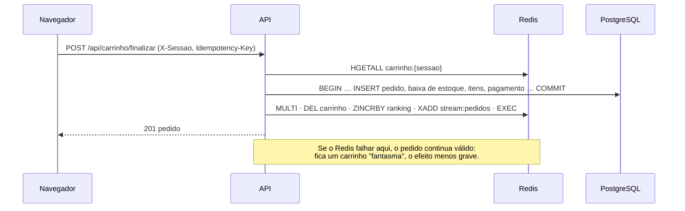

# Fase 3: NoSQL de documentos e chave-valor

**Tópico:** 8.8 (bancos NoSQL: documentos e chave-valor; MongoDB e Redis)
**Status:** ✅ implementada · exercícios do estudante em aberto (seção 5)

Esta fase também trouxe a **infraestrutura de testes** que vale daqui em
diante (seção 4) e o [`CLAUDE.md`](../../CLAUDE.md) com as regras do projeto.

## 1. Etapas

| # | Etapa | Entregáveis | Como verificar |
|---|---|---|---|
| 3.0 | Testes antes da fase | `internal/plataforma/testinfra` (bancos efêmeros), `internal/app` (montagem única), `e2e/` (Playwright, cenários, relatório) | `make check-db`, `make e2e` |
| 3.1 | Cenários de falha | [`e2e/CENARIOS.md`](../../e2e/CENARIOS.md) seções A e B, escritas **antes** do código | relatório lista A1–A8, B1–B7 |
| 3.2 | Esquema do catálogo | [`loja/adaptadores/mongo/esquema.go`](../../backend/internal/loja/adaptadores/mongo/esquema.go): coleções, `$jsonSchema`, 4 índices | Painel → MongoDB; teste `[A7]` grava por fora e é recusado |
| 3.3 | Seed do catálogo | [`loja/adaptadores/mongo/semente.go`](../../backend/internal/loja/adaptadores/mongo/semente.go), `cmd/seed-catalogo`: produtos a partir dos SKUs, avaliações, `$merge`, ranking | `make seed` |
| 3.4 | Busca | [`loja/adaptadores/mongo/busca.go`](../../backend/internal/loja/adaptadores/mongo/busca.go): `$text` + `$facet` | Loja; `[A1]`–`[A3]` |
| 3.5 | Produto e avaliações | [`loja/adaptadores/mongo/catalogo.go`](../../backend/internal/loja/adaptadores/mongo/catalogo.go): cache-aside, transação multi-documento | página do produto (selo HIT/MISS); `[A4]`–`[A8]` |
| 3.6 | Carrinho, ranking, stream, rate limit | [`loja/adaptadores/redis/redis.go`](../../backend/internal/loja/adaptadores/redis/redis.go), [`plataforma/limite/limite.go`](../../backend/internal/plataforma/limite/limite.go) | Carrinho; `[B1]`–`[B7]`, `[C1]`, `[C2]` |
| 3.7 | Painel NoSQL | [`painel/adaptadores/mongo/mongo.go`](../../backend/internal/painel/adaptadores/mongo/mongo.go) | Painel → Redis e MongoDB; `[G3]` |

## 2. Onde cada dado mora

| Dado | Banco | Estrutura | Por quê |
|---|---|---|---|
| Preço vigente, estoque, pedido | PostgreSQL | tabelas | precisa de ACID: é a **fonte da verdade** |
| Produto (nome, atributos, ofertas) | MongoDB `produtos` | documento | atributos diferentes por categoria; lido inteiro de uma vez |
| Categoria do produto | MongoDB `produtos.categorias` | **array de ancestrais** `[raiz, …, folha]` | filtrar pela raiz acha as descendentes sem CTE recursiva |
| Cópia do preço por oferta | MongoDB `produtos.skus[].preco` | Extended Reference (`Decimal128`) | ordenar e filtrar a busca; **pode ficar velha** |
| Avaliações | MongoDB `avaliacoes` | um documento cada (referencing) | quantidade ilimitada por produto |
| Resumo das avaliações | MongoDB `produtos.nota_media`, `qtd_avaliacoes`, `avaliacoes_recentes` | padrões **Computed** e **Subset** | a página mostra média e 3 últimas sem consultar `avaliacoes` |
| Página do produto | Redis `cache:produto:{id}` | STRING (JSON), TTL 5 min | cache-aside; invalidado quando entra avaliação |
| Carrinho | Redis `carrinho:{sessao}` | HASH `sku → quantidade`, TTL 7 dias | temporário, por sessão, sem rotina de limpeza |
| Mais vendidos | Redis `ranking:mais_vendidos` | SORTED SET | `ZINCRBY` na compra, `ZREVRANGE` na vitrine |
| Pedidos confirmados | Redis `stream:pedidos` | STREAM (`MAXLEN ~1000`) | log de eventos para consumidores (Fase 7) |
| Rate limit | Redis `rl:{rota}:{ip}:{minuto}` | STRING + `INCR`, TTL 2 min | janela fixa por IP |

### O fluxo do checkout pelo carrinho

## 3. Resultados medidos

Base: seed completo (100 mil pedidos, 2.001 SKUs → **1.030 produtos**, **7.303 avaliações**).

### Planos de execução no MongoDB (`explain("executionStats")`)

| Consulta | Plano | Documentos examinados |
|---|---|---|
| `$text: "notebook"` | `TEXT_MATCH > FETCH > IXSCAN` | **75** (só os que casam) |
| `nome: /notebook/i` (regex) | `COLLSCAN` | 1.030 (a coleção inteira) |
| `categorias: <raiz>` + `sort preco_min` | `FETCH > IXSCAN` (índice multikey `categoria_preco`) | 418 |
| a mesma, sem o índice (`hint _id`) | `SORT > FETCH > IXSCAN` | 1.030 + ordenação em memória |
| `skus.sku_id: <uuid>` | `EXPRESS_IXSCAN` (índice único em campo de array) | 1 |

### Cache e tamanhos

| Medida | Valor |
|---|---|
| Página do produto, **cache miss** (Mongo + PostgreSQL) | ~26 ms |
| Página do produto, **cache hit** (Redis + PostgreSQL) | ~2 ms |
| Documento do produto no Redis (`MEMORY USAGE`) | ~1,1 KB |
| Tamanho médio: produto / avaliação (`$collStats`) | 1.007 B / 192 B |
| `seed-catalogo` (agrupa, insere, `$merge`, ranking) | ~0,4 s |

### Testes da fase

| Suíte | Resultado |
|---|---|
| Integração (`make check-db`, 4 pacotes) | todos passam, ~10 s por pacote |
| E2E (`make e2e`) | **26 de 26** cenários, ~20 s de testes (+ ~1 min para subir e semear o stack) |

### O que os testes pegaram durante a fase

Cada item abaixo passou no "funciona na minha máquina" e foi pego por um teste:

| Teste | Defeito | Correção |
|---|---|---|
| integração `[A8]` | o cache **nunca** era gravado: o go-redis não serializa `json.RawMessage` (tipo nomeado) e o erro era ignorado | `[]byte(...)` + log do erro |
| integração `[B5]` | o carrinho não esvaziava: `pgtype.Numeric` no `XADD` derrubava o `MULTI` inteiro | total convertido para texto |
| integração (relatórios) | `vendas-mensais` dava 500 com a materialized view vazia (`sum()` de nada é `NULL`) | `coalesce` |
| `make seed` com volume | pânico no gerador de roupas (fatia além do array) | correção + teste unitário de todos os geradores |
| E2E (todos) | **tela em branco**: `crypto.randomUUID()` só existe em contexto seguro; por `http://IP` o app não carregava | gerador de UUID com `getRandomValues` |
| E2E `[A6]` | avaliação enviada antes da lista de clientes carregar saía sem cliente | botão desabilitado até carregar |

## 4. Como os testes funcionam agora

| | Nível | Bancos | Regra |
|---|---|---|---|
| ⚡ | `make check` | nenhum | só função pura (validação, geradores, `nomePublico`) |
| 🐘 | `make check-db` | PostgreSQL, MongoDB e Redis **efêmeros** (Testcontainers) | banco-modelo migrado uma vez e clonado por teste (`CREATE DATABASE … TEMPLATE`); database Mongo por teste; Redis com `FLUSHDB` |
| 🧭 | `make e2e` | stack `nosqlgo-e2e` (só o núcleo), semeado do zero | Playwright na imagem oficial, dentro da rede do stack; relatório com print de cada cenário |

Cassandra e Neo4j **não sobem** em nenhum desses níveis: entram na Fase 7.

## 5. Exercícios para você

- [ ] **Explain no mongosh:** repita a tabela da seção 3 e acrescente `$text` combinado com `categorias`. Qual índice o MongoDB escolhe? Por quê?
- [ ] **Cache com preço velho:** mude o preço de um SKU no PostgreSQL. O que a vitrine mostra? E a página do produto? Escreva como resolver (invalidação por evento, TTL menor, *write-through*).
- [ ] **Rate limit com janela deslizante:** troque a janela fixa por um sorted set (`ZADD` + `ZREMRANGEBYSCORE` + `ZCARD`) e mostre o defeito do "2× na virada do minuto" que ela resolve.
- [ ] **Consumidor do stream:** crie um *consumer group* (`XGROUP CREATE`, `XREADGROUP`, `XACK`) que leia `stream:pedidos`. O que acontece com as mensagens de um consumidor que caiu (`XPENDING`, `XCLAIM`)?
- [ ] **Busca no PostgreSQL:** implemente a mesma busca com `tsvector` + GIN (docs/04) e compare relevância, facetas e esforço com o `$text` + `$facet`.
- [ ] **Transação no Mongo:** derrube o replica set para standalone (no compose de teste) e veja a avaliação falhar. Por que transação exige replica set?
- [ ] **Avaliações sem transação:** reescreva `Avaliar` sem transação e com `$inc`. Monte o cenário em que a média fica errada.

## 6. Observações para as próximas fases

- O resumo de avaliações no produto é mantido incrementalmente; se divergir, o `make seed` recalcula com `$merge`. Uma rotina de reconciliação é tema da Fase 4.
- O carrinho é por sessão anônima (`X-Sessao`). Na Fase 6, com login, ele passa a ser do usuário — e o nome do cliente nas avaliações (`Ana S.`) já segue a minimização da LGPD.
- `stream:pedidos` ainda não tem consumidor: na Fase 7 ele alimenta o Cassandra (eventos) e o Neo4j (grafo de compras) — o padrão *outbox* começa aqui.
- O MongoDB e o Redis rodam sem autenticação: Fase 6 (keyfile e ACL).
